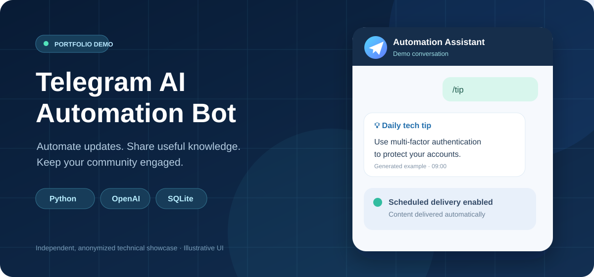
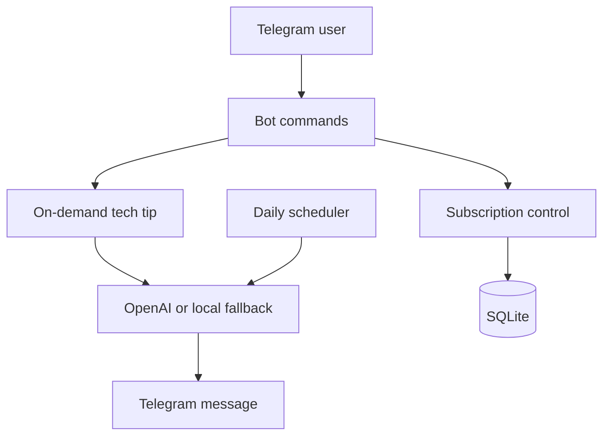

# Telegram AI Automation Bot



<p align="center"><strong>Automate communication. Deliver helpful content. Keep communities engaged.</strong></p>

<p align="center">
  
  
  
  
</p>

## Overview

**Telegram AI Automation Bot** is a Python project that helps teams and community managers automate repetitive communication in Telegram. It combines command-based interactions, optional AI-generated educational content, scheduled messages, and lightweight local storage.

The idea grew out of a real-world automation solution I developed for a company. This repository is an **independently rewritten, anonymized portfolio demonstration**, not the original client deployment. It contains no client branding, business information, production user data, private contact details, or credentials.

## Why it matters

Answering common questions, preparing recurring posts, and keeping a Telegram community active can take significant manual effort. A bot can handle predictable tasks automatically, freeing people to focus on conversations that actually require a human.

For a business or organization, this approach can help:

- **Save time:** automate scheduled educational updates instead of publishing each message manually.
- **Maintain consistency:** deliver information at predictable times with a recognizable format.
- **Improve accessibility:** offer simple self-service commands available at any time.
- **Support community engagement:** share relevant tips even when the team is busy.
- **Experiment with AI responsibly:** generate short informational messages with human-controlled configuration.

For community members, it provides an easy way to request useful content with `/tip`, understand available commands, and opt out of stored subscriptions with `/stop`.

> **Current demo scope:** scheduled posts go to one configured chat; `/tip` responds on demand. This version does not implement a customer-service ticket queue, human handoff, automatic FAQ matching, or broadcasts to stored subscriber IDs.

## Visual walkthrough

The image above is a **fictional interface illustration** showing how a short tip and a scheduled update might appear. It is not a screenshot of the original client bot or a live deployment.



## Features

- Telegram commands: `/start`, `/tip`, `/stop`, `/help`
- AI-generated educational technology tips via the OpenAI API
- Useful fallback tips when no OpenAI key is configured
- Optional daily scheduled messages to a configured Telegram chat
- Lightweight SQLite subscriber persistence, created locally at runtime
- Environment-based configuration; no hard-coded chat IDs or tokens

## Stack

Python · python-telegram-bot · OpenAI API · SQLite · python-dotenv

## Quick start

Requires Python 3.10+ and a Telegram bot token from [@BotFather](https://t.me/BotFather).

```bash
git clone https://github.com/natsouzax/telegram-ai-automation-bot.git
cd telegram-ai-automation-bot
python -m venv .venv
source .venv/bin/activate  # Windows: .venv\Scripts\activate
pip install -r requirements.txt
cp .env.example .env        # On Windows, copy the file manually
```

Set `TELEGRAM_BOT_TOKEN` in `.env`, then run:

```bash
python bot.py
```

To use AI-generated tips, set `OPENAI_API_KEY`. Otherwise, `/tip` works with a local demonstration message.

To enable a daily post at 09:00 in the configured time zone, set `ENABLE_SCHEDULED_POSTS=true` and a numeric `TELEGRAM_TARGET_CHAT_ID`. Scheduled posts are disabled by default. Only configure a destination you control or have permission to post to.

## Project structure

| File | Purpose |
| --- | --- |
| `bot.py` | Telegram handlers and scheduling |
| `config.py` | Environment-based settings |
| `content.py` | AI-based and fallback content generation |
| `storage.py` | Local SQLite subscriber records |
| `.env.example` | Safe configuration template |

## Privacy and scope

This repository contains demonstration logic and placeholder configuration only. It does not contain real Telegram user records, proprietary commercial content, credentials, or client screenshots. Runtime databases and `.env` files are excluded from Git. Never commit production data or secrets.

The code is provided as a technical portfolio example. It is not affiliated with or endorsed by the original client.

## Tests

Run `python -m unittest discover -s tests` from the project directory.
